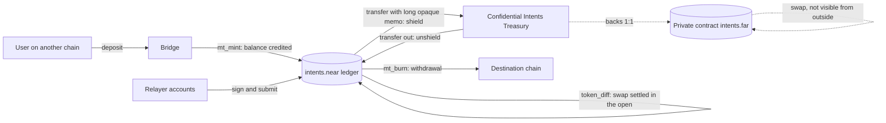

# Primer: what NEAR Intents is and how to read this project

A short introduction for readers who have not looked at NEAR Intents before. It describes only what NEAR's
documentation says or what the sampled transactions show.

## The idea in one paragraph

A user who wants to swap, say, USDT on Tron for USDC on Ethereum does not trade on an exchange. They state
what they want (an *intent*), and competing market makers (*solvers*) offer to fill it. Settlement happens
inside one smart contract on NEAR, `intents.near`, which keeps a ledger of who owns which bridged token.
Most users never touch NEAR directly: an app or wallet handles it, and a *relayer* submits the transaction.

## The path of a swap

| Step | On-chain event we read | What it tells us |
|---|---|---|
| Deposit | `nep245:mt_mint` | Value entering, and from which chain |
| Open swap | `dip4:token_diff` | A swap anyone can inspect: who gave what for what |
| Shield | `dip4:transfer` into the treasury | Value moving to the confidential side |
| Confidential swap | none on `intents.near` | Not observable from outside |
| Unshield | `dip4:transfer` out of the treasury | Value returning to the public ledger |
| Withdrawal | `nep245:mt_burn` | Value leaving, and to which chain |

## Why an investor should care

- **Volume is the pitch.** NEAR Intents volume is the most quoted figure in the NEAR investment case.
- **Revenue follows volume, at a rate NEAR sets.** Users pay about 16 basis points; NEAR keeps about 5.
- **Structure decides durability.** Who can submit transactions, who holds the funds, and how much of the
  activity can be audited determine whether the volume is a moat or a dependency.

## Glossary

| Term | Meaning |
|---|---|
| Intent | A signed statement of the outcome a user wants, for example "give me at least X of token B for Y of token A" |
| Solver | A market maker that fills intents from its own inventory |
| Relayer | An account that submits transactions on behalf of users and pays the network fee |
| Signer | The account that signed and submitted a transaction; what test T5 measures |
| `intents.near` | The public contract that verifies intents and keeps the token ledger |
| 1Click | NEAR's swap API used by wallets and apps; its token list supplies our asset ids, decimals and prices |
| Shield / unshield | Moving funds into / out of the confidential side through the treasury account |
| Confidential Intents Treasury | The account that holds the public tokens backing every shielded balance |
| `intents.far` | The private contract where confidential swaps execute, per NEAR's documentation |
| Basis point (bps) | One hundredth of a percent. 5 bps of $100 is 5 cents |
| Take (rate) | The share of volume a protocol keeps as revenue |
| Published volume | DefiLlama's daily NEAR Intents volume, which comes from NEAR's own data tables |
| Implicit account | A NEAR account named by a 64-character key hash, typically created automatically for a user |
| Named account | A NEAR account with a readable name such as `solver-priv-liq.near` |
| Stratum | One equal slice of the period; one window is sampled from each |
| Window | 40 consecutive blocks whose transactions are all downloaded |
| Bootstrap | Re-drawing the sample from itself many times to see how much a figure could vary |
| 95% interval | The range that holds the middle 95% of bootstrap results |
| Pooled estimate | A precision-weighted average of independent samples |
| HHI | Herfindahl–Hirschman index, a concentration measure; above 2,500 is usually called highly concentrated |
| Out-of-sample | Checked on data that was not available when the rule was written |

## How to read a result

Every sample-based figure looks like **72.5% (66.4% to 78.5%)**: the estimate, then its 95% interval. A test
passes or fails only when the *whole* interval is on one side of its threshold. When it straddles, or when
two samples disagree, the verdict is "inconclusive" and we say so.
