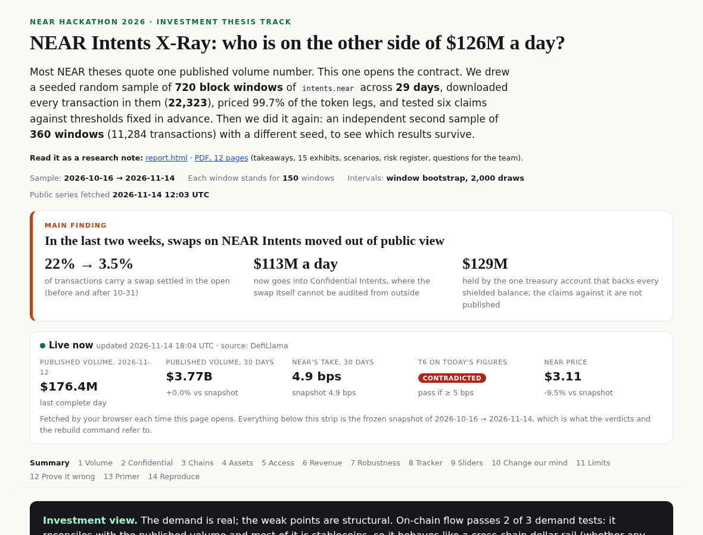

# NEAR Intents X-Ray

**An evidence-first investment thesis for NEAR that opens the `intents.near` contract instead of quoting
its headline volume.** Built at NEAR HACKATHON (1–14 November 2026), track: Investment Thesis (`thesis`).

- **Live dashboard: https://eren-dotcom.github.io/near-intents-xray/**
- Repository: https://github.com/Eren-dotcom/near-intents-xray
- Demo video (76 s, narrated walkthrough of the dashboard): [`docs/NEAR-Intents-X-Ray-demo.mp4`](docs/NEAR-Intents-X-Ray-demo.mp4)
- Dashboard source: [`docs/index.html`](docs/index.html) (one self-contained file; the only network call is the labelled "Live now" strip; served by GitHub Pages from `/docs`)
- Research note (12 pages: takeaways, 15 exhibits, scenarios, risk register, questions for the team): [`docs/NEAR-Intents-X-Ray-report.pdf`](docs/NEAR-Intents-X-Ray-report.pdf) · [`docs/report.html`](docs/report.html)
- New to NEAR Intents: [`PRIMER.md`](PRIMER.md) (how a swap moves, glossary) · Full method: [`METHODOLOGY.md`](METHODOLOGY.md) (estimators, event dictionary, a worked example) · Hands-on: [`TUTORIAL.md`](TUTORIAL.md) (seven exercises) · References: [`SOURCES.md`](SOURCES.md)
- Written thesis: [`THESIS.md`](THESIS.md) (claim, evidence for, evidence against, what would change our mind)
- One command rebuilds everything: `python3 rebuild.py`
- Dated predictions the daily tracker scores automatically: [`predictions.json`](predictions.json)



## The problem

Every thesis on NEAR leans on one figure: NEAR Intents volume. That figure comes from NEAR's own Dune
tables. Nobody outside can tell from it whether the flow is real, who settles it, which chains it comes
from, or who is allowed to submit it. Those are the questions that decide whether the volume is a moat
or a dependency.

## What this is

A reproducible measurement of the contract itself:

1. **A seeded random sample of mainnet.** The last 30 days are cut into 720 one-hour strata; one window of
   40 consecutive blocks is drawn in each. Every transaction touching `intents.near` in those windows is
   downloaded with its event logs (keyless, FastNEAR transactions API).
2. **Population estimates with honest error bars.** Sample totals are expanded by stratum ÷ window. Every
   share has a 95% interval from a bootstrap over whole windows.
3. **Six claims with thresholds fixed in advance** (`thesis_tests.json`). A claim is "supported" or
   "contradicted" only if its entire interval is on one side of the threshold.
4. **Two independent checks on the method.** Sampled deposits are compared with the published volume, and
   the sampled transaction count is compared with the exact count for the same days.
5. **A replication and four sensitivity runs.** Every sample-based test is repeated on an independent second
   sample (different seed, 360 windows), on each half of the period, with every item of $100K or more
   removed, and with a different price source. The dashboard shows which verdicts survive.
6. **An out-of-sample check.** A third sample (seed 31337, 360 windows) was drawn after the verdict rule was
   fixed. Its verdicts are reported next to the headline ones, which were not changed after seeing it.
7. **The confidential side, measured from outside.** Value entering and leaving the documented Confidential
   Intents Treasury, the date swaps left the public contract (with a bootstrap range), who shields, and what
   the treasury holds.
8. **Context.** NEAR's take next to other cross-chain venues, what today's market value asks of Intents
   revenue, net flow by chain, and when the contract is used.
9. **Forward tests.** A daily tracker and five dated predictions it scores automatically.

## Results

<!--RESULTS-->
| Test | Claim | Measured (95% interval) | Verdict |
| --- | --- | --- | --- |
| T1 | The published volume is real: value entering the contract on-chain matches it | 0.70× (0.56× to 0.84×) | **supported** (main: supported; replication: inconclusive; pooled: supported) |
| T2 | Demand is multi-chain: no single chain supplies half of the deposits | 29.2% (21.6% to 36.8%) | **inconclusive** (main: supported; replication: inconclusive; pooled: supported) |
| T3 | It is a dollar rail: stablecoins are most of the value moved | 72.5% (66.4% to 78.5%) | **supported** (main: supported; replication: supported; pooled: supported) |
| T4 | Settlement is NOT concentrated: no single account sends half of the value | 44.2% (39.1% to 49.4%) | **inconclusive** (main: supported; replication: inconclusive; pooled: supported) |
| T5 | Access is NOT concentrated: the five busiest signers submit under 90% of transactions | 97.6% (97.4% to 97.8%) | **contradicted** (main: contradicted; replication: contradicted; pooled: contradicted) |
| T6 | NEAR captures value: revenue is at least 5 bps of volume (30 days) | 4.9 bps | **contradicted** |

**Investment view.** The demand is real; the weak points are structural. On-chain flow passes 2 of 3 demand tests: it reconciles with the published volume and most of it is stablecoins, so it behaves like a cross-chain dollar rail (whether any one chain supplies half of it is not settled by two samples). That is the bull case, and it is checkable. The structure fails 2 of 3 tests: five relayer accounts submit 97% of all transactions and NEAR keeps only 4.9 bps of the volume. So the long-term case for the NEAR token is not "Intents volume goes up". It is "NEAR opens up who can submit transactions and raises its take without losing the volume". This repository measures each of those, and can be re-run to see whether they move. And one finding cuts both ways: 78% of the value we can see being settled now moves through Confidential Intents, a ledger outsiders cannot audit. That is real demand for privacy, and it also means the public evidence this thesis rests on is shrinking.

**The finding we did not expect.** The account at the centre of the public ledger is the Confidential Intents Treasury, named in NEAR's own documentation (https://docs.near-intents.org/integration/market-makers/confidential-example). About $85M a day is shielded into Confidential Intents ($59M to $116M), in roughly 30,695 transfers a day. Swaps that settle in the open on the public contract come to about $27M a day. So of the value we can see being settled either way, 77.6% (95% CI 71.5% to 83.7%) goes to the confidential side (two samples pooled). In the main sample the share was 59% in the earlier 15 days and 88% in the later 15. The swap itself then executes against a separate private contract, so outsiders can count what goes in and out but not what happens inside.

Main sample: 720 windows, 22,323 transactions; replication sample: 360 windows, 11,284 transactions; 2026-10-16 to 2026-11-14. Built 2026-11-26 12:29 UTC.
<!--/RESULTS-->

## Try it (for judges)

| Do | See |
| --- | --- |
| Open `docs/index.html` in a browser | The investment view, six verdict cards, fifteen charts each with "How this is computed", the robustness table (section 7), the daily tracker (section 8) and threshold sliders (section 9) |
| `python3 rebuild.py` (about 3 minutes) | `analyze.py` recomputes `data/derived/numbers.json` from the committed raw sample, `build_report.py` rewrites the dashboard, `THESIS.md` and the Results table above, then all tests print `ok` |
| Open the dashboard online | The "Live now" strip loads today's published volume, NEAR's take and price from DefiLlama |
| `python3 rebuild.py --track` (about 10 minutes, needs network) | A new row for the last 24 hours appears in section 8 and in `data/history/tracker.jsonl` |
| Read section 2 of the dashboard | The day swaps left the public contract, and what the confidential treasury holds |
| Open `predictions.json`, then section 8 | Five predictions dated 2026-11-14 and their running score from the tracker |
| `python3 scripts/treasury.py` (needs network) | The treasury's current holdings are re-read from the chain into `data/public/treasury_balance.json` |
| Open `docs/data/*.csv` | The numbers behind the charts (daily series, tests, robustness, treasury, tracker) |
| Read section 12 of the dashboard | Six ways to try to prove the thesis wrong, each with its command |
| `python3 scripts/try_test.py confidential.shield_share_of_transfers below 0.5` | Your own claim is judged with the same rule: estimate, 95% interval, verdict |
| Drag a slider in section 9 of the dashboard | The verdict for that test is recomputed in the browser |
| Edit a threshold in `thesis_tests.json`, run `python3 rebuild.py` | The verdict badge, the prose and the investment view change accordingly |
| `python3 tests/test_all.py` | Estimator unit tests, a check that the committed windows equal the seeded sampling plan, and sanity checks on the output |
| `python3 rebuild.py --fetch` | Public series refreshed (DefiLlama, 1Click prices, exact daily transaction counts) |
| `python3 rebuild.py --resample` | A brand-new sample drawn from mainnet (about 40 minutes on the keyless endpoint; the old sample is moved to `data/raw/previous/`) |

Requirements: Python 3.9 or newer. Standard library only. No API keys.

## How it works

| File | What it does |
| --- | --- |
| `scripts/sample_onchain.py` | Draws the windows (seeded), lists every transaction in each, downloads receipts, keeps `intents.near` event logs. Resumable. Waits out rate limits and never skips a transaction silently. |
| `scripts/fetch_public.py` | DefiLlama volume, fees, revenue and NEAR price; 1Click token list (chain, decimals, price); exact daily transaction counts from FastNEAR. |
| `scripts/analyze.py` | Values every token leg, builds per-window aggregates, computes estimates and bootstrap intervals, writes `data/derived/numbers.json`. |
| `scripts/build_report.py`, `charts.py`, `thesis_md.py` | Render the dashboard (inline SVG), `THESIS.md` and the Results block. No figure is typed by hand. |
| `thesis_tests.json` | The six pass/fail rules. |
| `sql/bigquery_intents_usage.sql` | Optional cross-checks on the NEAR BigQuery public dataset. **Not executed** (see Limits). |
| `tests/test_all.py` | Zero-dependency tests. |
| `data/raw/` | Main sample: `sample_config.json` (end height, seed, sizes), `windows.jsonl` (every window and its transaction hashes), `sample_txs.jsonl.gz` (the transactions). |
| `data/raw_b/` | Replication sample, same layout, different seed. |
| `data/raw_c/` | Third sample (seed 31337), drawn after the verdict rule was fixed: an out-of-sample check. It does not change the headline verdicts. |
| `data/public/peers.json`, `market.json`, `treasury_balance.json` | Peer venues' 30-day volume, fees and revenue (DefiLlama); NEAR market value (CoinGecko); the treasury's holdings read from the chain. |
| `data/history/tracker.jsonl`, `predictions.json` | Daily tracker rows and the five dated predictions they score. |
| `docs/data/*.csv` | The numbers behind the charts. |
| `data/public/` | Public series as fetched: DefiLlama, 1Click token list, daily prices, exact transaction counts. |
| `.github/workflows/rebuild.yml` | CI: rebuilds from raw data on every push and fails if the committed thesis or numbers differ from the fresh build. |

### What is read from the contract

| Event | Used for |
| --- | --- |
| `nep245:mt_mint` | Deposits: value entering the ledger, by source chain |
| `nep245:mt_burn` | Withdrawals: value leaving, by destination chain |
| `dip4:transfer` into the documented treasury account | Value shielded into Confidential Intents |
| `dip4:transfer` | Value moved between accounts inside the ledger: who sends, who receives, which asset, what size |
| `dip4:token_diff` | The second settlement path (small in this sample; reported separately) |
| transaction `signer_id` | Who submits transactions |

## How NEAR fits in

The subject is NEAR's own verifier contract, `intents.near`, on mainnet. The whole analysis is possible
because the contract emits structured NEP-297 events (`dip4`, `nep245`) for every deposit, transfer and
withdrawal, so cross-chain flow that starts on Ethereum, Solana, Bitcoin or Tron becomes auditable in one
place. The thesis is about what that ledger shows.

## Limits (read before citing a number)

- It is a sample. Shares are estimates with intervals; value shares are noisier than count shares because a
  few very large transfers carry much of the value.
- Amounts are valued at each asset's USD price on the day of the transaction; intraday moves are not captured.
- Thresholds were fixed after a 6-window pilot and before the full sample was drawn, and not changed afterwards.
- One account is identified from NEAR's public documentation (the Confidential Intents Treasury). All other
  accounts are described by behaviour only; no claim is made about who operates them.
- The confidential ledger is seen from outside only. What happens on the private contract is taken from
  NEAR's documentation, not observed. Shielded value includes solver liquidity, so it is an upper bound on
  confidential swap size.
- The rule for combining the two samples was written after both were drawn (see THESIS.md).
- Live data is kept apart from the evidence. The "Live now" strip is fetched by the browser from DefiLlama and
  is the only network call the page makes. The daily tracker (`scripts/track.py`, run by
  `.github/workflows/daily.yml`) samples only 96 windows of the last 24 hours, so its rows have wide intervals
  and carry no verdict. Neither changes the frozen 30-day snapshot that `python3 rebuild.py` reproduces.
- The published volume, fees and revenue series are NEAR's Dune tables as relayed by DefiLlama. The volume
  is checked against the sample; revenue is not independently re-derived.
- The BigQuery queries in `sql/` were written but **not run** (no billing account). The NEAR Intents
  Explorer API needs a partner JWT and was **not used**.
- Research, not investment advice.

## Disclosure

- All code in this repository was written during the hackathon window. No earlier code.
- Two-project disclosure (organizers' Q-015): this is one of two independent projects submitted by the same person to NEAR HACKATHON. The other is RecallTag (https://github.com/Eren-dotcom/recalltag), a NEAR prototype for product recalls and custody handovers (Open Innovation track). The two projects are independent and share no code.
- AI coding assistance was used to write the code and draft the text.
- Libraries: none beyond the Python standard library.
- Data sources: FastNEAR transactions API (`tx.main.fastnear.com`), DefiLlama (`api.llama.fi`,
  `coins.llama.fi`), 1Click token list (`1click.chaindefuser.com`).

## For automated judges

```sh
python3 rebuild.py          # exit code 0 and a final line "all checks passed"
python3 tests/test_all.py   # the same checks alone
```

- Claims and thresholds: `thesis_tests.json`. Measured values and intervals: `data/derived/numbers.json`
  (keys `reconciliation`, `chains`, `assets`, `ledger`, `access`, `public`, `robustness`).
- Every figure in `THESIS.md`, `docs/index.html` and the Results table is written by `scripts/build_report.py`
  from that JSON; none is typed by hand.
- To verify one raw observation, take any hash from `data/raw/windows.jsonl` and look it up on a NEAR explorer.

## License

MIT. See `LICENSE`.
